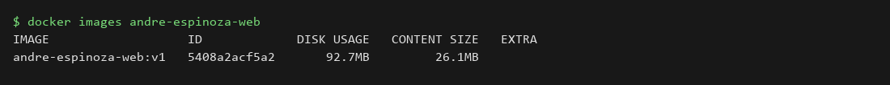
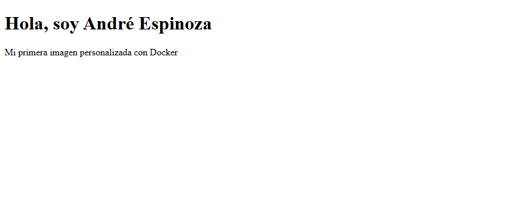

# laboratorio 01 - primera imagen docker

## datos del alumno
**nombre:** André Espinoza
**imagen:** andre-espinoza-web:v1
**puerto:** 8080

## objetivo
crear una imagen docker propia a partir de nginx que muestre mi nombre en una página html.

## procedimiento
### 1. construcción de la imagen
```bash
docker build -t andre-espinoza-web:v1 .
```
### 2. ejecución del contenedor
```bash
docker run -d --name andre-espinoza-web -p 8080:80 andre-espinoza-web:v1
```
### 3. comprobación
```bash
curl http://localhost:8080
```

## evidencias
### imagen docker construida


### página funcionando


## resultado
la imagen se construyó sobre `nginx:stable-alpine`, copié mi `index.html` al directorio web de nginx y el contenedor responde en el puerto 8080 mostrando "Hola, soy André Espinoza".

## conclusiones
`FROM` elige la imagen base y `COPY` mete mi html adentro. con solo dos líneas ya tengo una imagen propia que se puede levantar en cualquier lado.