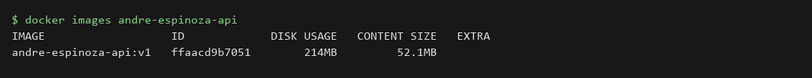
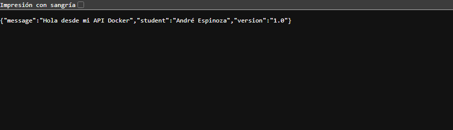
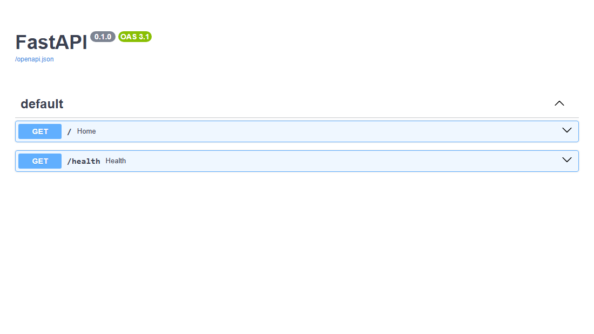

# laboratorio 02 - dockerizar una api con fastapi

## datos del alumno
**nombre:** André Espinoza
**imagen:** andre-espinoza-api:v1
**puerto:** 8081

## objetivo
construir una imagen que instale las dependencias de python y ejecute una api fastapi con endpoints que se puedan verificar.

## procedimiento
### 1. construcción de la imagen
```bash
docker build -t andre-espinoza-api:v1 .
```
### 2. ejecución del contenedor
```bash
docker run -d --name andre-espinoza-api -p 8081:8000 andre-espinoza-api:v1
```
### 3. prueba de los endpoints
```bash
curl http://localhost:8081/
curl http://localhost:8081/health
# docs interactiva: http://localhost:8081/docs
```

## qué hace cada instrucción
| instrucción | para qué sirve |
|---|---|
| `FROM` | usa python 3.12 slim como base |
| `WORKDIR` | define `/app` como carpeta de trabajo |
| `COPY` | copia primero los requirements y después el código |
| `RUN` | instala las dependencias al construir la imagen |
| `EXPOSE` | documenta que la app usa el puerto 8000 |
| `CMD` | arranca uvicorn como proceso principal |

`--no-cache-dir` es de pip: no guarda su caché de descargas dentro de la imagen. no es lo mismo que `docker build --no-cache`, que desactiva el caché de capas de docker.

## evidencias
### imagen construida


### respuesta json de `/`


### documentación automática en `/docs`


## resultado
la api responde en el 8081 con mi nombre en el campo `student` y `/health` devuelve `{"status":"ok"}`.

## conclusiones
aprendí a armar una imagen de una app python: dependencias en su propia capa y el código al final.