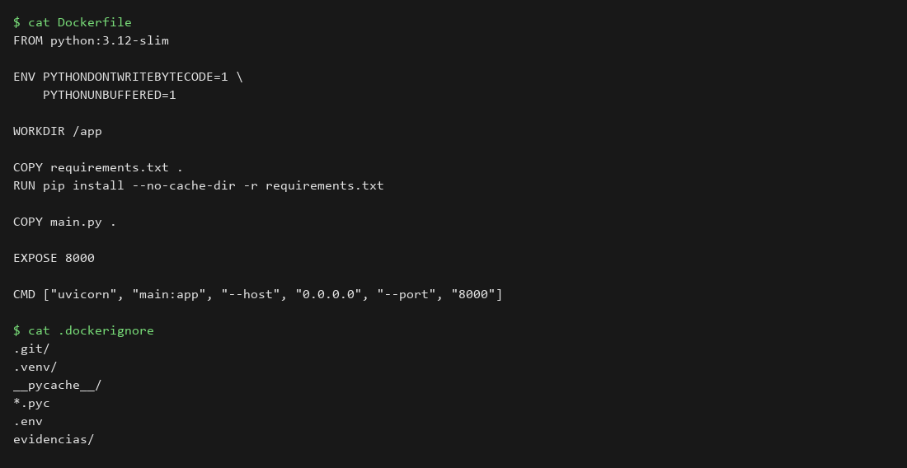
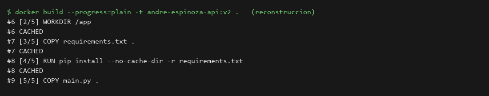
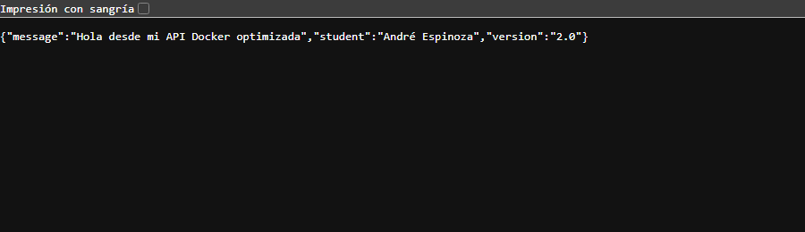

# laboratorio 03 - optimización del dockerfile

## datos del alumno
**nombre:** André Espinoza
**imagen:** andre-espinoza-api:v2
**puerto:** 8082

## objetivo
optimizar la construcción con el orden de las capas, el caché de docker y la exclusión de archivos que no hacen falta.

## cambios respecto al lab 02
- variables de entorno `PYTHONDONTWRITEBYTECODE=1` y `PYTHONUNBUFFERED=1`
- `.dockerignore` con `.git/`, `.venv/`, `__pycache__/`, `*.pyc`, `.env` y `evidencias/`
- el orden ya estaba bien: primero `requirements.txt`, luego el `pip install` y al final `main.py`

## procedimiento
```bash
docker build --progress=plain -t andre-espinoza-api:v2 .
# cambié solo el mensaje de main.py y reconstruí sin --no-cache
docker build --progress=plain -t andre-espinoza-api:v2 .
docker run -d --name andre-espinoza-api-v2 -p 8082:8000 andre-espinoza-api:v2
curl http://localhost:8082/
```

## evidencias
### dockerfile optimizado y .dockerignore


### reconstrucción con pasos reutilizados (CACHED)


### api funcionando en el 8082


## resultado
al cambiar solo `main.py`, las capas de `WORKDIR`, `COPY requirements.txt` y `pip install` salieron como `CACHED`. solo se rehízo el `COPY main.py`, así que la reconstrucción fue casi instantánea.

## conclusiones
el orden de las instrucciones importa: lo que casi no cambia (dependencias) va arriba y lo que cambia seguido (código) va al final.