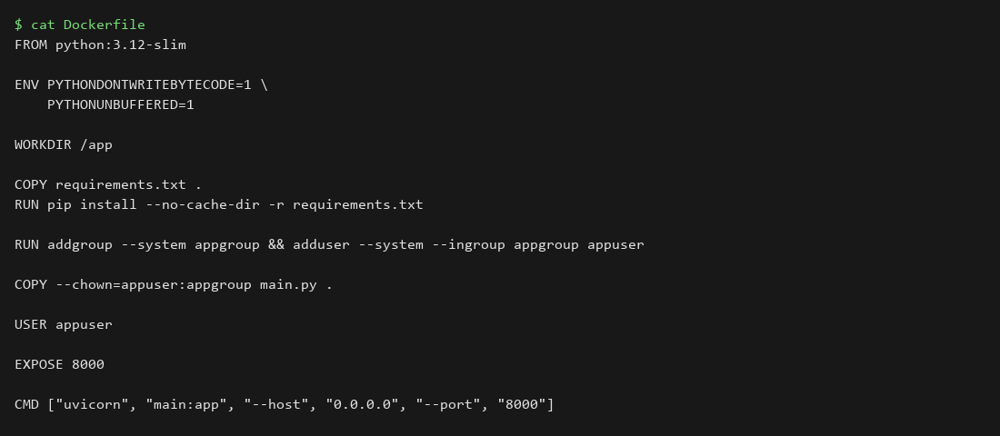
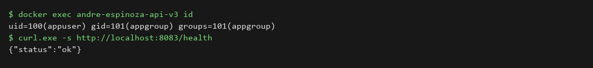
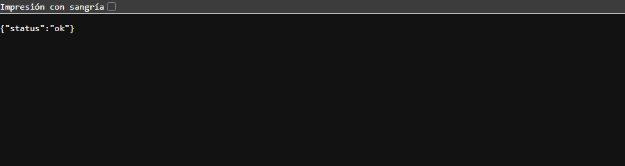

# laboratorio 04 - seguridad y buenas prácticas

## datos del alumno
**nombre:** André Espinoza
**imagen:** andre-espinoza-api:v3
**puerto:** 8083

## objetivo
que el proceso de la app corra con un usuario distinto de root sin que deje de funcionar.

## cambios respecto al lab 03
- creo un usuario y grupo de sistema: `addgroup --system appgroup && adduser --system --ingroup appgroup appuser`
- `COPY --chown=appuser:appgroup main.py .` para que el usuario pueda leer el código
- `USER appuser` antes del `CMD`
- se mantienen las variables de entorno y el `.dockerignore`

## procedimiento
```bash
docker build -t andre-espinoza-api:v3 .
docker run -d --name andre-espinoza-api-v3 -p 8083:8000 andre-espinoza-api:v3
docker exec andre-espinoza-api-v3 id
curl http://localhost:8083/health
```

## evidencias
### dockerfile con la creación del usuario y `USER`


### `docker exec ... id` (uid distinto de 0)


### `/health` en el 8083


## resultado
`id` muestra `uid=100(appuser)`, o sea que no es root (uid 0), y `/health` sigue respondiendo `{"status":"ok"}`.

## conclusiones
si alguien llega a vulnerar la app, no tendría privilegios de root dentro del contenedor. es un cambio chico en el dockerfile y mejora bastante la seguridad.